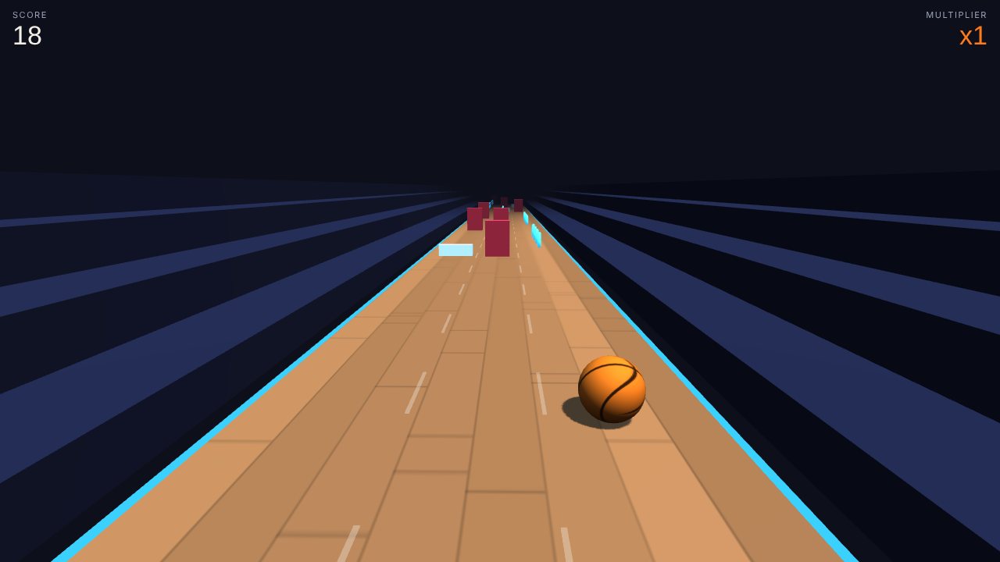

# Fast Break

A 3D endless runner built with Three.js. A basketball rolls down a scrolling court while you dodge defenders, jump low screens, and collect orbs to build a score multiplier.

**[▶ Play in your browser](https://kalebkebede-dev.github.io/fast-break/)** (works on desktop and mobile)

## Controls
| Input | Action |
|---|---|
| **A / D** or **arrow keys** | Switch lanes (swipe left or right on mobile) |
| **W / Space / Up** | Jump (swipe up or tap on mobile) |

## Rules
- Defenders (red) block a lane, so switch lanes to get past them
- Screens (white) are low, so jump over them
- Orbs add 25 × your multiplier; every 10 collected in a row raises the multiplier (max x8)
- Speed ramps up over time and rows get closer together
- Best score saves in the browser

## How it works
- **Game loop:** `requestAnimationFrame` with a capped delta time so slow frames don't break physics.
- **Movement:** smoothed lane switching plus a gravity-based jump arc; the camera follows the ball for a sense of weight.
- **Spawner:** every row leaves at least one lane open, so every row is passable, and the gap between rows shrinks as speed increases.
- **Collision:** distance checks per object type; screens can be cleared by jumping, defenders cannot.
- **Rendering:** the hardwood floor and ball textures are generated with the Canvas API, so the game ships as one HTML file with no image assets.
- **Input:** keyboard and touch-swipe handling share the same lane and jump functions.

## Run locally
Open `index.html` in any modern browser. No build step or install is needed.

## Roadmap
- [ ] Power-ups such as a shield or slow-motion
- [ ] Sound effects and music
- [ ] Pause menu and difficulty settings

## License
MIT
